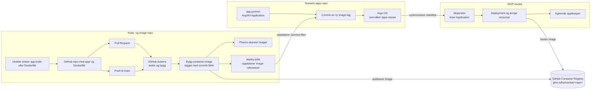

# Arbeidsflyt: fra kode til applikasjon på SKIP

Applikasjonskoden og utrullingsbeskrivelsen ligger i hvert sitt repo. Kode-repoet bygger og publiserer container-imaget, mens apps-repoet beskriver hvilken versjon som skal kjøre på SKIP.

## Slik leser du flyten

1. På en Pull Request kjører GitHub Actions tester og bygger imaget som kontroll, men publiserer det ikke.
2. Når endringen merges til `main`, kjører workflowen test og bygg på nytt. Bygget image publiseres til GHCR med commit-SHA som tagg; `latest` oppdateres også.
3. Pharos skanner imaget. Deploy-jobben bruker Octo STS til å oppdatere image-taggen i `app.jsonnet` i teamets apps-repo, og committer endringen der.
4. Argo CD oppdager endringen i apps-repoet og synkroniserer Jsonnet-manifestet. ArgoKit gjør det om til en Skiperator `Application`.
5. Skiperator oppretter eller oppdaterer ressursene i clusteret. Workloaden henter det publiserte imaget fra GHCR.

Før automatisert deploy er aktivert, må `app.jsonnet` og ArgoKit være lagt inn i apps-repoet, og kode-repoet må ha `APPS_REPO`, `APPS_MANIFEST_PATH` og Octo STS-tillit konfigurert. Se [instruksjonene for apps-repoet i README](README.md#apps-repoet-slik-deployes-det-til-skip).
