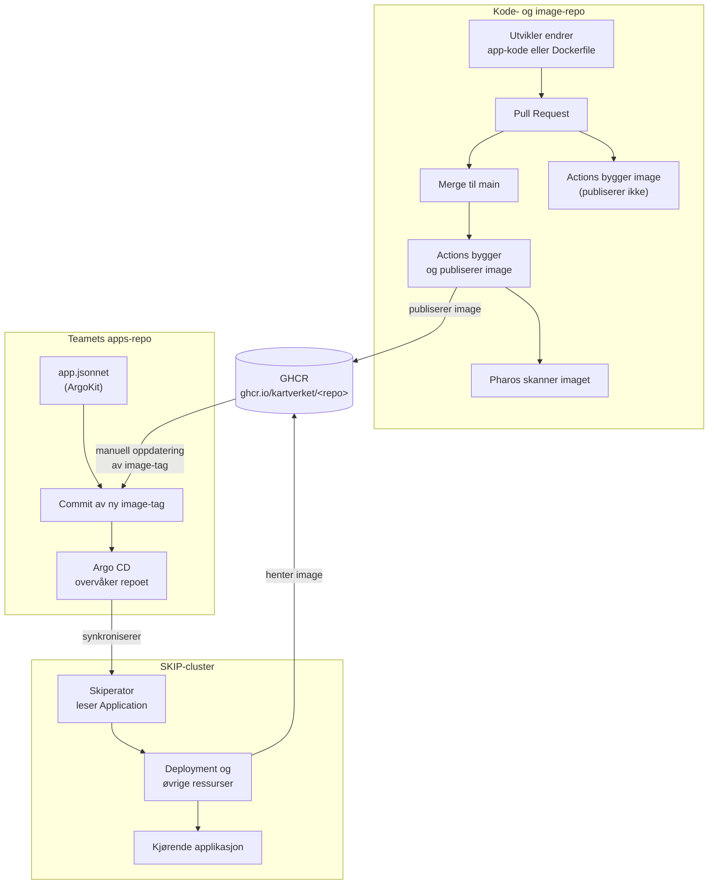

# Arbeidsflyt: fra kode til applikasjon på SKIP

Applikasjonskoden og utrullingsbeskrivelsen ligger i hvert sitt repo. Kode-repoet bygger og publiserer container-imaget, mens apps-repoet beskriver hvilken versjon som skal kjøre på SKIP.

## Slik leser du flyten

1. På en Pull Request bygger GitHub Actions imaget som kontroll, men publiserer det ikke.
2. Når endringen merges til `main`, bygger og publiserer workflowen imaget til GHCR med commit-SHA og `latest`-tagg. Pharos skanner imaget.
3. I hovedløypa oppdaterer du image-taggen manuelt i apps-repoets `app.jsonnet` og pusher endringen. Automatisk image-oppdatering fra GitHub Actions er en ekstraoppgave.
4. Argo CD oppdager endringen i apps-repoet og synkroniserer Jsonnet-manifestet. ArgoKit gjør det om til en Skiperator `Application`.
5. Skiperator oppretter eller oppdaterer ressursene i clusteret. Workloaden henter det publiserte imaget fra GHCR.

For automatisk image-oppdatering må `app.jsonnet` og ArgoKit være lagt inn i apps-repoet, og kode-repoet må ha `APPS_REPO`, `APPS_MANIFEST_PATH` og Octo STS-tillit konfigurert. Se [ekstraoppgaven i README](README.md#oppgave-b-automatiser-image-oppdateringen-i-apps-repoet).
